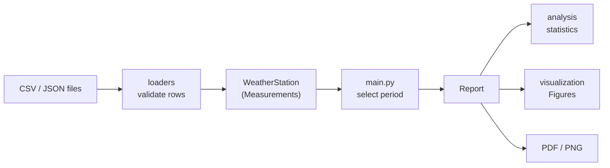
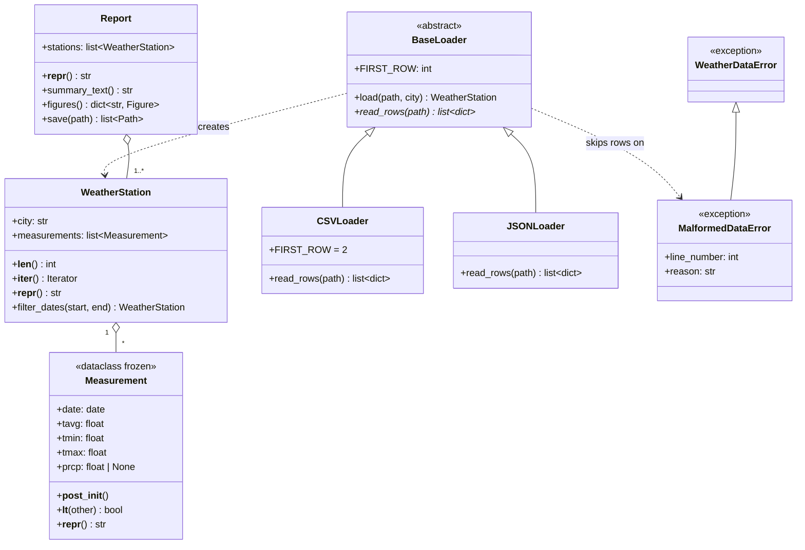

# Weather Data Explorer: Design Document

## 1. Purpose

Weather Data Explorer is a command-line tool and a small Python package.
- It loads historical daily weather for several cities from CSV or JSON files and validates every record.
- It computes statistics: monthly averages, extremes, the temperature trend, anomaly days, frost/hot/rainy day counts and the longest dry spell.
- It writes a PDF or PNG report with a line chart, a histogram and heatmaps for the cities and period the user selects.

## 2. Data flow

`main.py` parses the arguments and loads one `WeatherStation` per file. It cuts each station to the selected period and hands the stations to `Report`. `Report` asks `analysis` for the numbers and `visualization` for the figures, then writes the output.

## 3. Class diagram

**Modules**

| Module | Responsibility |
|---|---|
| `models.py` | `Measurement` (one day) and `WeatherStation` (one city's days, sorted) |
| `loaders.py` | `parse_row`, `BaseLoader` → `CSVLoader` / `JSONLoader`, `load_station` (picks the loader by file extension) |
| `analysis.py` | Pure functions: `summary`, `extremes`, `monthly_averages`, `anomaly_days`, `temperature_trend`, `day_counts`, `longest_dry_spell` |
| `visualization.py` | Pure functions returning a Matplotlib `Figure`: line chart, histogram, heatmap |
| `report.py` | `Report`: the text summary, the named figures, and PDF/PNG output |
| `exceptions.py`, `logger.py` | The exception hierarchy and logging setup |
| `main.py` | argparse CLI: arguments, period selection, exit codes |

## 4. Design decisions

1. **`Measurement` validates itself.** It is a frozen, slotted dataclass, and `__post_init__` rejects these values:
   - `nan` or infinite values;
   - `tmin ≤ tavg ≤ tmax` not holding;
   - negative precipitation.

   An invalid measurement can't exist, so no other code repeats these checks. `__lt__` orders measurements by date, which is how `WeatherStation` keeps them sorted.
2. **Loaders use a template method.** `BaseLoader.load` does the shared work:
   - checks that the file exists;
   - parses each row with `parse_row`;
   - logs and skips rows that raise `MalformedDataError`;
   - fails if no valid rows remain.

   Subclasses implement only `read_rows`: `csv.DictReader` for CSV and `json.load` for JSON. Adding a format means writing one small class and registering its file extension in `LOADERS`.
3. **Analysis is plain functions, not a class.** Each statistic takes a station and returns plain data, so it can be tested with a few hand-made measurements. Classes are kept for things worth modelling: a day, a city, a file format, a report.
4. **Seasons are removed before statistics that compare days.** Anomaly days are measured against each calendar month's own mean and standard deviation, so an ordinary cold January day isn't an anomaly. The trend is a straight-line fit (`np.polyfit`) after the same monthly means are subtracted. It is only reported when the data covers at least 2 years.
5. **Figures are built without `pyplot`.** `Figure()` objects need no GUI backend and no global state, so tests run headless. The summary pages are figures too (five cities per A4 page), which means a PDF and a set of PNGs come from the same list of figures.
6. **The CLI stays thin.** The city name comes from the file name, and the output format comes from the file extension. That keeps the CLI to two date options and one output option.

## 5. Error handling

| Problem | Exception | Handled by | User sees |
|---|---|---|---|
| Bad row (date, number, `nan`/`inf`, `tmin > tavg`, negative rain, missing field, non-object JSON record) | `MalformedDataError` | loader: skip row | `WARNING Skipping row 42: …` |
| Missing, unreadable or non-UTF-8 file; unknown extension; missing CSV columns; invalid JSON; no valid rows | `WeatherDataError` | `main()` | one `ERROR` line, exit code 1 |
| No data in the selected period; same city given twice; output not `.pdf`/`.png`; output not writable | `WeatherDataError` | `main()` | one `ERROR` line, exit code 1 |
| Invalid argument or date, `--start` after `--end` | argparse | argparse | usage message, exit code 2 |

`MalformedDataError` is a subclass of `WeatherDataError`. The loader catches the specific row error, and the CLI catches everything from the package with one `except`.

## 6. Testing

pytest, with one test file per module and 105 tests in total:
- **Models and loaders:** valid input, every validation rule, and every file-level error. Input files are written to `tmp_path`.
- **Analysis:** every statistic on hand-made data with a known answer. This includes a seasons-only series giving a zero trend, and the per-month anomaly baseline.
- **Visualization:** figure structure (lines per city, grid shape, blank months), not pixels.
- **Report and CLI:** the PDF and PNG files written, period selection, and the exit codes for data errors and argument errors.

Run the tests with `pytest` from the project root.
