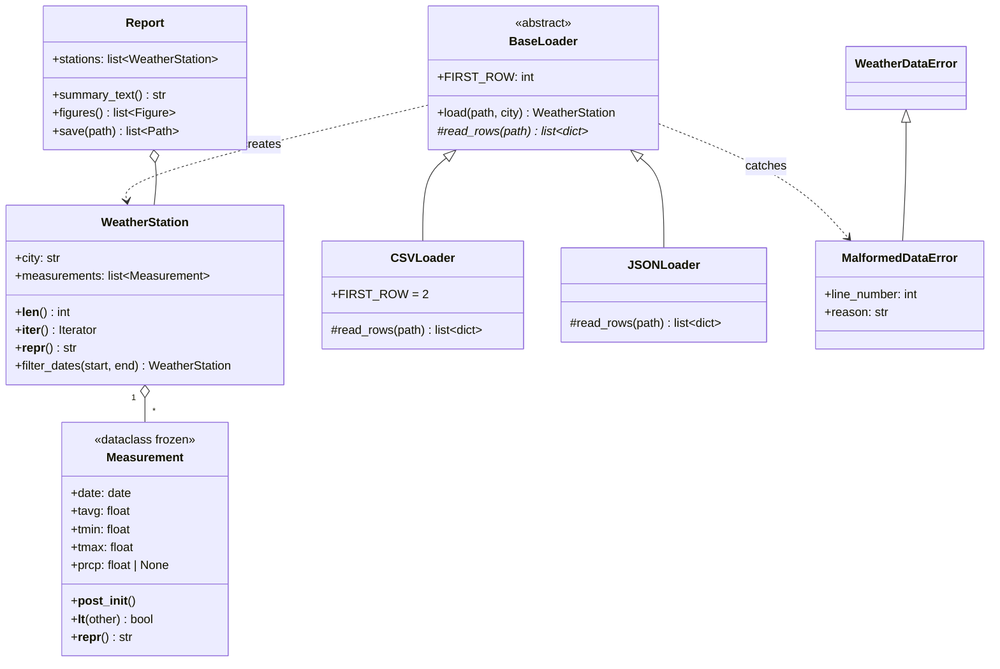

# Weather Data Explorer: Project Guide

> **This is the single source of truth for the project.** It replaced the earlier `roadmap.md`, `review.md` and `walkthrough.md` (deleted).
> Last updated: 2026-10-29 · Current state: **Phase 1 done**, Phases 2–5 to go.

**The one rule:** build the MVP that satisfies [Task.md](../Task.md), and nothing more. Every file, class and function below exists because a line of the task asks for it ([§3](#3-requirements-traceability) maps each one back). If something is not in that table, we don't build it.

---

## 1. Context

- **Course project** for a team of 2, rated **2/10 (easy)**. It uses only Python fundamentals: no machine learning, no web, no database.
- **The grade comes from code quality**: a clean class design, proper error handling and tests. The breadth of features doesn't earn marks. A small, tidy, well-tested codebase beats a big one.
- **Data:** daily historical weather from [Meteostat](https://meteostat.net) (CC BY-NC 4.0, attribution required).

## 2. The Task

The original text is in [Task.md](../Task.md). Here it is broken down into checkable requirements:

| ID | Requirement (from Task.md) |
|---|---|
| R1 | Object-oriented package of classes, e.g. `WeatherStation`, `Measurement`, `Report` |
| R2 | Read raw **CSV and JSON** data for **several cities** |
| R3 | **Validate** the data, using **custom exceptions** for malformed data, plus **logging** |
| R4 | Statistics: **monthly averages, extremes, trends, anomaly days** |
| R5 | OOP techniques: **classes, inheritance, dunder methods, dataclasses** |
| R6 | Idioms: **list/dict comprehensions, `Counter`, `defaultdict`, `itertools`** |
| R7 | Standard Library: **`csv`, `json`, `pathlib`, `datetime`, `argparse`, `statistics`** |
| R8 | **NumPy** vectorized computations |
| R9 | **Matplotlib** plots: **line, histogram, heatmap** |
| R10 | **argparse CLI** that produces a **PDF/PNG report** for **selected cities and periods** |
| R11 | **Unit tests** (pytest) |
| R12 | **Short design document with a class diagram** |

## 3. Requirements traceability

Each row shows where a requirement is met, and the phase that delivers it.

| ID | Where it is satisfied | Phase |
|---|---|---|
| R1 | `Measurement`, `WeatherStation` (models.py), `Report` (report.py) | 1 ✅ / 4 |
| R2 | `CSVLoader`, `JSONLoader`, `load_station()` (loaders.py); 3 city files in `data/` | 1 ✅ / 2 |
| R3 | `WeatherDataError`, `MalformedDataError`; loader skips bad rows and logs them; CLI logs fatal errors | 1 ✅ / 2 / 5 |
| R4 | `monthly_averages`, `extremes`, `temperature_trend`, `anomaly_days` (analysis.py) | 3 |
| R5 | dataclass `Measurement`; dunders `__lt__`, `__repr__`, `__len__`, `__iter__`; `BaseLoader(ABC)` → `CSVLoader`, `JSONLoader` | 1 ✅ / 2 |
| R6 | list comprehension in `filter_dates`; `defaultdict` + dict comprehension in `monthly_averages`; `Counter` in `day_counts`; `itertools.groupby` in `longest_dry_spell` | 1 ✅ / 3 |
| R7 | `csv`/`json` (loaders), `pathlib` (everywhere), `datetime` (models, CLI), `statistics` (analysis), `argparse` (main.py) | 1 ✅ / 2 / 3 / 5 |
| R8 | NumPy for trend (`np.polyfit`), anomaly z-scores, histogram/heatmap arrays | 3 / 4 |
| R9 | `plot_monthly_temperature` (line), `plot_temperature_histogram` (hist), `plot_monthly_heatmap` (heatmap) | 4 |
| R10 | `main.py`: positional files, `--start`/`--end`, `--output report.pdf\|.png` | 5 |
| R11 | `tests/test_models.py` ✅, `test_loaders.py`, `test_analysis.py`, `test_report.py` | every phase |
| R12 | `docs/design.md`, with a Mermaid class diagram | 5 |

---

## 4. Current state of the repo (after Phase 1, commit `2d56ff2`)

```
WeatherDataExplorer/
├── data/budapest.csv          ✅ 1,827 daily rows, 2021-10-17 → 2026-10-17
├── weather/
│   ├── __init__.py            ✅ re-exports the public API
│   ├── exceptions.py          ✅ WeatherDataError, MalformedDataError(line_number, reason)
│   ├── logger.py              ✅ setup_logging(verbose)
│   ├── models.py              ✅ Measurement (frozen/slots dataclass), WeatherStation
│   ├── loaders.py             ✅ CSVLoader (header check, skips + logs bad rows)
│   └── analysis.py            ⚠️ placeholder WeatherAnalyzer (gets replaced in Phase 3)
├── tests/test_models.py       ✅ 21 tests, all passing
├── docs/projectGuide.md       ✅ this guide
├── main.py                    ⚠️ hard-coded demo (becomes the CLI in Phase 5)
├── pyproject.toml             ✅ pytest config (testpaths, pythonpath)
├── requirements.txt           ✅ numpy, matplotlib, pytest
├── .vscode/settings.json      ✅ uses .venv, hides caches
├── .gitignore, README.md, Task.md
```

**Verified on 2026-10-29:**
- `pytest`: **21 passed**.
- `python main.py` loads 1,827 records with **0 skipped**. Mean temperature 12.85 °C, max 39.1 °C (2026-08-05), min −10.7 °C (2026-01-09).
- **Data quality:**
  - `tavg`, `tmin` and `tmax` are complete.
  - `prcp` is missing on 247 days, which become `None`.
  - `snow` is empty in every row.
  - There are no duplicate dates.
- **Environment:** `.venv` has Python 3.13, numpy 2.5, matplotlib 3.11 and pytest 9.1. **The code needs Python ≥ 3.10** because it uses `slots=True` and `X | Y` types.

**What is good and stays:**
- The immutable `Measurement`.
- `WeatherStation` sorts its measurements on construction and returns a new station from `filter_dates`.
- The two-level exception hierarchy.
- The `utf-8-sig` BOM handling.
- The `REQUIRED_COLUMNS` header check.
- The pytest config, so `tests/` needs no `__init__.py`.

**What is wrong or missing:**
- Only one city, and no JSON loader or file (R2).
- No analysis (R4), plots (R9), report or CLI (R10).
- Date and number parse errors raise a bare `ValueError` instead of `MalformedDataError` (R3).
- `.gitignore` doesn't ignore generated reports.
- The README has no data source and doesn't state the Python version.

---

## 5. Target architecture

### 5.1 Design in one paragraph

Data flows in one direction:

**files → loaders → `WeatherStation` → analysis functions → plots → `Report` → PDF/PNG**

- **Models** are plain data.
- **Loaders** turn files into models, and are the only place that touches raw input.
- **Analysis** is a set of pure functions: station in, numbers out. That makes each one trivial to test with synthetic data.
- **Visualization** is pure functions too: stations in, `Figure` out.
- **`Report`** is the only orchestrator.
- **`main.py`** only parses arguments and handles fatal errors.

Classes are used where they model something: a measurement, a station, a family of loaders, a report. Functions are used everywhere else. No class exists just to hold functions.

### 5.2 Final repo layout

```
WeatherDataExplorer/
├── data/
│   ├── budapest.csv           # existing
│   ├── debrecen.csv           # NEW: second city, CSV
│   └── vienna.json            # NEW: third city, JSON (exercises JSONLoader)
├── weather/
│   ├── __init__.py            # public API
│   ├── exceptions.py          # unchanged
│   ├── logger.py              # unchanged
│   ├── models.py              # + validation in Measurement.__post_init__
│   ├── loaders.py             # BaseLoader(ABC), CSVLoader, JSONLoader, load_station()
│   ├── analysis.py            # pure functions (statistics, numpy, collections, itertools)
│   ├── visualization.py       # NEW: line, histogram, heatmap → Figure
│   └── report.py              # NEW: Report class → PDF or PNGs
├── tests/
│   ├── test_models.py         # existing (+2 validation tests)
│   ├── test_loaders.py        # NEW
│   ├── test_analysis.py       # NEW
│   └── test_report.py         # NEW: report output + CLI end-to-end
├── docs/
│   ├── projectGuide.md        # this file (internal plan)
│   └── design.md              # NEW: the deliverable design doc + class diagram
├── output/                    # generated reports (git-ignored)
├── main.py                    # argparse CLI
├── pyproject.toml, requirements.txt, README.md, Task.md, .gitignore, .vscode/
```

That's 8 modules, 4 test files and 2 docs. There's no `utils.py`, `config.py`, `cli/` package, plugin system or settings file.

### 5.3 Class diagram (target)



### 5.4 Module specifications

#### `models.py` (one small change)

- Add `__post_init__` to `Measurement`. It raises `ValueError` if `not tmin <= tavg <= tmax` or if `prcp < 0`. After this, an invalid `Measurement` can't exist, and the loader no longer repeats these checks.
- Leave everything else as it is.

#### `exceptions.py`, `logger.py`

No changes.

#### `loaders.py`

`load` is a template method: the shared steps live in the base class, and each subclass supplies only how to read its file format.

```python
class BaseLoader(ABC):
    FIRST_ROW = 1                       # CSV overrides with 2 (the header is line 1)

    def load(self, path: Path, city: str) -> WeatherStation:
        # 1. raise WeatherDataError if the file is missing
        # 2. rows = self.read_rows(path)
        # 3. for each row: try parse_row(...) except MalformedDataError → log a warning and skip
        # 4. raise WeatherDataError if no valid rows; otherwise return a WeatherStation

    @abstractmethod
    def read_rows(self, path: Path) -> list[dict]: ...

class CSVLoader(BaseLoader):    # csv.DictReader, utf-8-sig, keeps the REQUIRED_COLUMNS check
class JSONLoader(BaseLoader):   # json.load → must be a list of objects, else WeatherDataError

def parse_row(row: dict, line_no: int) -> Measurement:
    # wraps ValueError/TypeError/KeyError into MalformedDataError(line_no, reason)
    # accepts values as strings (CSV) or numbers/null (JSON); "" or None prcp → None

LOADERS = {".csv": CSVLoader, ".json": JSONLoader}

def load_station(path: Path) -> WeatherStation:
    # choose the loader by path.suffix (unknown suffix → WeatherDataError)
    # city = path.stem.title(), so "vienna.json" becomes "Vienna"
```

#### `analysis.py`: pure functions, replacing `WeatherAnalyzer`

Each function takes a `WeatherStation` and returns plain data.

| Function | Returns | Technique (req.) |
|---|---|---|
| `summary(station)` | `{"mean", "median", "stdev"}` of `tavg` | `statistics` (R7) |
| `extremes(station)` | `{"hottest", "coldest", "wettest"}` → `Measurement` | `max`/`min` with `key=` |
| `monthly_averages(station)` | `{(year, month): mean_tavg}` | `defaultdict(list)` + dict comprehension (R4, R6) |
| `anomaly_days(station, threshold=2.0)` | `list[Measurement]` | NumPy z-score **per calendar month** (R4, R8) |
| `temperature_trend(station)` | °C per year (float) | `np.polyfit` on the de-seasonalised series (R4, R8) |
| `day_counts(station)` | `Counter({"frost": n, "hot": n, "rainy": n})` | `Counter` (R6) |
| `longest_dry_spell(station)` | `int` (days) | `itertools.groupby` (R6) |

**How each statistic is defined.** Write these in the docstrings.

- **Anomaly day:** a day whose `tavg` is more than 2σ from the mean of **its own calendar month**, taken across all years. Comparing against a single yearly mean would only flag ordinary winter and summer days.
- **Trend:** first subtract each day's calendar-month mean to remove the seasons. Then take the slope of a straight-line fit of that series against the number of days since the start, and multiply by 365.25 to get °C per year. Removing the seasons means a partial year at the start or end doesn't skew the slope.
- **Frost day:** `tmin < 0`. **Hot day:** `tmax ≥ 30`. **Rainy day:** `prcp ≥ 1.0` mm. A single day can count in more than one category.
- **Dry day:** `prcp == 0`. A missing `prcp` (`None`) is *not* dry, so it breaks a streak.

> Anomaly days and the trend both need each calendar month's mean and σ. Put that in one private helper, `_month_stats(station)`, built with NumPy.

#### `visualization.py`

- Every function returns a `matplotlib.figure.Figure`.
- Build figures with `Figure()` directly rather than `pyplot`. That avoids GUI backends and global state, so tests run headless and nothing leaks memory.

| Function | Plot (R9) |
|---|---|
| `plot_monthly_temperature(stations)` | **Line**: monthly mean `tavg` over time, one line per city |
| `plot_temperature_histogram(stations)` | **Histogram**: daily `tavg` distribution, overlaid per city (`alpha=0.5`) |
| `plot_monthly_heatmap(station)` | **Heatmap**: years × 12 months of mean `tavg` (`imshow` + colorbar), one per city |

#### `report.py`

```python
class Report:
    def __init__(self, stations: list[WeatherStation]) -> None: ...
    def summary_text(self) -> str:        # one block per city: period, records, summary,
                                          # extremes, trend, anomaly count, day counts, dry spell
    def figures(self) -> list[Figure]:    # [summary page, line, histogram, one heatmap per city]
    def save(self, path: Path) -> list[Path]:
        # .pdf → one multi-page PDF via PdfPages
        # .png → one PNG per figure: <stem>_1_summary.png, <stem>_2_line.png, …
        # any other suffix → WeatherDataError
```

- The summary page is a `Figure` containing `fig.text(...)` in a monospace font. That way PDF and PNG output go through the same code path, and there's no table library.

#### `main.py`

```
python main.py FILE [FILE ...] [--start YYYY-MM-DD] [--end YYYY-MM-DD]
                               [-o output/report.pdf] [-v]
```

- **Files:** positional. Each file is one city, and the city name comes from the file name.
- **Dates:** `--start`/`--end` use `type=date.fromisoformat`, so a bad date gets argparse's own clean error. Each station is filtered with `filter_dates`. A station left empty raises `WeatherDataError("No data for <city> in the selected period")`.
- **Output:** `-o/--output` defaults to `output/report.pdf`. The suffix (`.pdf` or `.png`) chooses the format, so there's no separate `--format` flag. The parent folder is created if needed.
- **Logging:** `-v` sets logging to DEBUG.
- **Structure:** write it as `def main(argv: list[str] | None = None) -> int` so tests can call it directly.
- **Errors:** wrap the body in `try / except WeatherDataError as e: logger.error(e); return 1`, and end the file with `raise SystemExit(main())`.

### 5.5 Error handling at a glance

| Problem | Raised | Handled | User sees |
|---|---|---|---|
| Bad row (date, number, `tmin > tavg`, negative rain, missing key) | `MalformedDataError` | the loader skips it | `WARNING Skipping row 42: …` |
| Missing file, unknown extension, missing CSV columns, invalid JSON, 0 valid rows | `WeatherDataError` | `main()` | `ERROR …`, exit code 1 |
| Empty period after filtering | `WeatherDataError` | `main()` | `ERROR No data for X in the selected period`, exit code 1 |
| Bad CLI argument or date | argparse | argparse | usage message, exit code 2 |

---

## 6. Phases

Each phase ends with `pytest` green and a commit or PR. Tests are written **in the same phase** as the code they cover, not saved for the end.

### Phase 1: Skeleton and models ✅ DONE
The package skeleton, the exceptions and logger, `Measurement`, `WeatherStation`, a working `CSVLoader`, the demo `main.py` and 21 model tests.

### Phase 2: Loading and validation (next)

**Modify**
- `models.py`: add `Measurement.__post_init__` validation.
- `loaders.py`:
  - Add `BaseLoader(ABC)`.
  - Make `CSVLoader` inherit from it.
  - Add `JSONLoader`, `parse_row()` and `load_station()`.
  - Remove the inline checks that moved to `__post_init__`.
- `__init__.py`: export the new names.
- `main.py`: use `load_station`. It's still a demo at this point.

**Add**
- `data/debrecen.csv`: a Meteostat daily export for the same period as Budapest.
- `data/vienna.json`: a Meteostat daily export for the same period, converted to a JSON list of objects using the same keys as the CSV (one-off command below; don't commit a script for it).
- `tests/test_loaders.py`. Write the input files to `tmp_path`, then check:
  - a valid CSV and a valid JSON load the same measurements;
  - a bad row is skipped, a valid row still loads, and a warning is logged (`caplog`);
  - a missing file, a missing column, an unknown extension and invalid JSON each raise `WeatherDataError`;
  - a file with zero valid rows raises `WeatherDataError`;
  - `load_station` takes the city name from the file name.
- `tests/test_models.py`: add 2 tests checking that `__post_init__` rejects bad temperature order and negative rain.

Converting a CSV export to JSON:

```bash
python -c "import csv,json,sys; json.dump(list(csv.DictReader(open(sys.argv[1],encoding='utf-8-sig'))),open(sys.argv[2],'w'),indent=1)" vienna.csv data/vienna.json
```

> When you add each new city, check how many rows it skips. Smaller Meteostat stations often have an empty `tavg`. If more than a few percent of rows are skipped, pick a bigger station rather than writing fallback logic.

**Done when:** all 3 data files load with few or no skipped rows, and `pytest` is green.

### Phase 3: Analysis

**Modify**
- Rewrite `analysis.py` as the 7 functions in §5.4, plus `_month_stats`.
- Delete `WeatherAnalyzer`.
- Update `main.py` and `__init__.py` to match.

**Add**
- `tests/test_analysis.py`. Use small synthetic stations whose answers are known:
  - a constant series has trend 0 and no anomalies;
  - a known outlier is flagged;
  - monthly averages are correct over 2 months;
  - `day_counts` is correct on hand-made days;
  - the dry spell is correct, including when broken by `None`;
  - the extremes return the right `Measurement`.

**Done when:** every function has at least one test with a known answer.

### Phase 4: Plots and report

**Add**
- `weather/visualization.py`: the 3 plot functions.
- `weather/report.py`: the `Report` class.
- `tests/test_report.py`:
  - `summary_text()` contains each city name;
  - `figures()` has 3 + N figures, where N is the number of cities;
  - `save("x.pdf")` creates a non-empty file;
  - `save("x.png")` creates one PNG per figure;
  - `save("x.txt")` raises `WeatherDataError`.

Don't test the pixels of the plots. Only check that the figures exist.

**Done when:** a PDF for all 3 cities opens and looks right when checked by eye.

### Phase 5: CLI, docs and polish

**Modify**
- `main.py`: the full argparse CLI from §5.4.
- `.gitignore`: add `output/`.
- `README.md`:
  - Requires Python 3.10+;
  - setup steps;
  - 3 example commands;
  - data source with Meteostat attribution;
  - links to the docs.

**Add**
- `docs/design.md`, the graded deliverable, kept to 1–2 pages:
  - purpose;
  - the data flow;
  - the class diagram from §5.3;
  - the main design decisions and why (dataclass, template-method loaders, pure analysis functions, the error-handling table from §5.5);
  - how to run the tool and its tests.
- CLI end-to-end tests in `test_report.py`:
  - `main([csv, "-o", tmp/report.pdf])` returns 0 and creates the file;
  - a missing file returns 1;
  - an empty period returns 1.

**Done when** the commands in §7 work.

#### Team of 2: suggested split
- **Phase 2:** one person does the loaders and their tests; the other gets the two new data files.
- **Phases 3 and 4:** these can run in parallel. One person does `analysis.py`, the other `visualization.py`. They only meet in `Report`.
- **Phase 5:** together.

---

## 7. MVP acceptance checklist (final)

```bash
pytest                                                    # all green
python main.py data/budapest.csv data/debrecen.csv data/vienna.json            # → output/report.pdf
python main.py data/budapest.csv --start 2024-01-01 --end 2024-12-31 -o output/bp2024.png
python main.py data/missing.csv                           # → one ERROR line, exit 1
```

- [ ] R1–R12 are each satisfied, as mapped in §3
- [ ] The PDF has a summary page with the stats for each city, a line chart, a histogram and one heatmap per city
- [ ] No tracebacks for any user error
- [ ] `docs/design.md` has the class diagram
- [ ] The README lets a fresh clone run the tool in 3 commands

## 8. Docs cleanup

| File | Decision | Why |
|---|---|---|
| `docs/projectGuide.md` | **keep** | the single internal plan |
| `docs/design.md` | **create in Phase 5** | the graded deliverable (R12) |
| `docs/roadmap.md` | **deleted** ✅ | superseded by §5–6 of this guide |
| `docs/review.md` | **deleted** ✅ | its findings are folded into this guide |
| `docs/walkthrough.md` | **deleted** ✅ | Phase 1 tutorial; it hard-codes line numbers and goes stale, and `design.md` covers the rationale |

## 9. Changes to the previous plan (and why)

| Change | Type | Reason |
|---|---|---|
| Replaced the `WeatherAnalyzer` class with pure functions | modified | Simpler and easier to test, and the task only asks for classes that model something |
| Validation moved into `Measurement.__post_init__`; `parse_row()` raises `MalformedDataError` for every bad row | modified | One place for the rules, and consistent exceptions |
| `BaseLoader.load()` as a template method; subclasses implement only `read_rows()` | modified | The JSON loader is about 5 lines, with no duplicated validation |
| Anomalies measured against each calendar month | modified | A single yearly μ/σ only flags ordinary winter and summer days |
| Added `temperature_trend()` | **added** | "Trends" is in the task; the old plan only had smoothing |
| Dropped the 7-day rolling mean | **removed** | Not in the task |
| Cities: Budapest (CSV), Debrecen (CSV), Vienna (JSON), instead of Kecskemét + `budapest.json` | modified | "Several cities" means 3, and a JSON file for a *different* city tests the JSON loader while adding a city; a duplicate of Budapest would add nothing |
| Dropped `--cities` (name from the file) and `--format` (from the `--output` suffix) | **removed** | Fewer flags and nothing to get out of sync |
| PNG output = one file per figure; no multi-panel dashboard | simplified | The same code path as the PDF |
| `Figure()` instead of `pyplot` | modified | Headless, no global state |
| Mermaid class diagram in `design.md`; no PNG export | simplified | No extra tool needed, and GitHub renders it |
| One test file per module plus CLI end-to-end; no separate `test_visualization.py` | simplified | Plots are covered through `Report` |
| `output/` in `.gitignore`; Python ≥ 3.10 and data source in the README | added | Small gaps found in the review |
| `roadmap.md`, `review.md` and `walkthrough.md` replaced by this guide | **removed** | One document to keep up to date |

**Explicitly out of scope:** a database, a web UI, downloading data through an API, config files, packaging/`setup.py`, CI pipelines, more weather variables (wind, pressure, snow), forecasting and machine learning.
