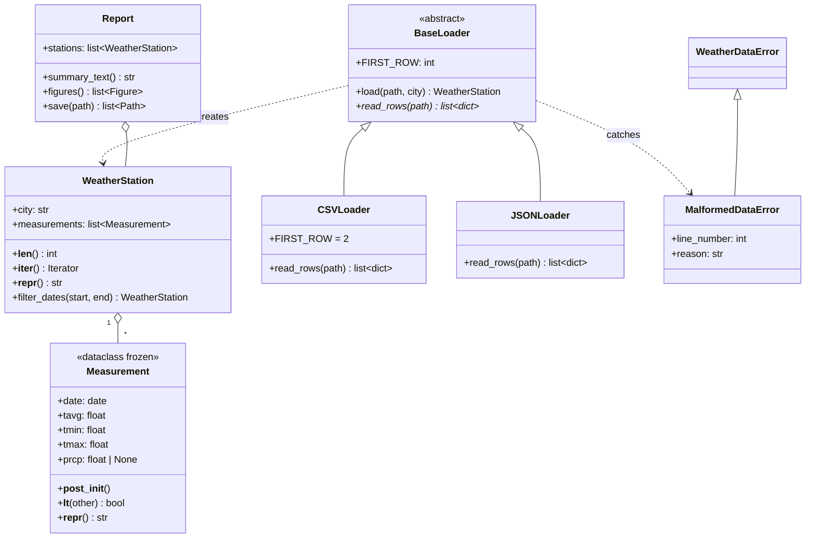

# Weather Data Explorer: Project Guide

> The single reference for the project: the task, the design, the data, and what is done and what is left.
> Last updated: 2026-10-29 · **Phases 1–3 done ✅ · Phases 4–5 to do ⏳**

**Guiding rule:** build the smallest clean version that fully meets [Task.md](../Task.md). Every module, class and function exists because a line of the task asks for it, as mapped in [§3](#3-requirements-traceability). Anything not in that map is out of scope.

---

## 1. Context

- **What:** a command-line Python toolkit. It loads daily historical weather for several cities, validates it, computes statistics, and writes a PDF or PNG report with plots.
- **Who:** a course project for a team of 2, rated **2/10 (easy)**. It uses only Python fundamentals: no machine learning, no web, no database.
- **How it's graded:** on code quality, meaning a clean class design, proper error handling and tests. A small, tidy, well-tested codebase is the goal, not a long feature list.
- **Data:** daily observations from [Meteostat](https://meteostat.net), licensed CC BY-NC 4.0 (attribution required). See [§5](#5-data).

## 2. The task

The original text is in [Task.md](../Task.md). Here it is as checkable requirements:

| ID | Requirement |
|---|---|
| R1 | Object-oriented package of classes, e.g. `WeatherStation`, `Measurement`, `Report` |
| R2 | Read raw **CSV and JSON** data for **several cities** |
| R3 | **Validate** the data, with **custom exceptions** for malformed data, plus **logging** |
| R4 | Statistics: **monthly averages, extremes, trends, anomaly days** |
| R5 | OOP: **classes, inheritance, dunder methods, dataclasses** |
| R6 | Idioms: **list/dict comprehensions, `Counter`, `defaultdict`, `itertools`** |
| R7 | Standard Library: **`csv`, `json`, `pathlib`, `datetime`, `argparse`, `statistics`** |
| R8 | **NumPy** vectorized computations |
| R9 | **Matplotlib** plots: **line, histogram, heatmap** |
| R10 | **argparse CLI** producing a **PDF/PNG report** for **selected cities and periods** |
| R11 | **Unit tests** (pytest) |
| R12 | **Short design document with a class diagram** |

## 3. Requirements traceability

| ID | Where it is met | Status |
|---|---|---|
| R1 | `Measurement`, `WeatherStation` (models.py); `Report` (report.py) | ✅ / ⏳ Phase 4 |
| R2 | `CSVLoader`, `JSONLoader`, `load_station()` (loaders.py); `budapest.csv`, `debrecen.csv`, `vienna.json` | ✅ |
| R3 | `WeatherDataError`, `MalformedDataError`; `Measurement` validates itself; loaders skip and log bad rows; CLI reports fatal errors | ✅ / ⏳ Phase 5 (CLI) |
| R4 | `monthly_averages`, `extremes`, `temperature_trend`, `anomaly_days` (analysis.py) | ✅ |
| R5 | dataclass `Measurement`; dunders `__post_init__`, `__lt__`, `__repr__`, `__len__`, `__iter__`; `BaseLoader(ABC)` → `CSVLoader`, `JSONLoader` | ✅ |
| R6 | comprehensions in `filter_dates`, `extremes`, `monthly_averages`, `anomaly_days`; `defaultdict` in `monthly_averages`; `Counter` in `day_counts`; `itertools.groupby` in `longest_dry_spell` | ✅ |
| R7 | `csv`, `json` (loaders); `pathlib` (loaders, main); `datetime` (models, loaders); `statistics` (analysis); `argparse` (main.py) | ✅ / ⏳ Phase 5 (`argparse`) |
| R8 | NumPy in `_month_stats`, `anomaly_days` (vectorized z-scores), `temperature_trend` (`np.polyfit`); heatmap grid | ✅ / ⏳ Phase 4 |
| R9 | `plot_monthly_temperature` (line), `plot_temperature_histogram` (histogram), `plot_monthly_heatmap` (heatmap) | ⏳ Phase 4 |
| R10 | `main.py`: positional files, `--start`/`--end`, `-o report.pdf\|.png` | ⏳ Phase 5 |
| R11 | `test_models.py`, `test_loaders.py`, `test_analysis.py` ✅; `test_report.py` ⏳ | ✅ / ⏳ Phases 4–5 |
| R12 | `docs/design.md` with a Mermaid class diagram | ⏳ Phase 5 |

---

## 4. Architecture

### 4.1 Data flow

```
files ──▶ loaders ──▶ WeatherStation ──▶ analysis ──▶ visualization ──▶ Report ──▶ PDF / PNG
(csv/json)  (validate)   (Measurements)   (numbers)    (Figures)        (assemble)
                                                        ▲
                                    main.py (argparse) ─┘ chooses files, period, output
```

- **Models** are plain data. A `Measurement` that exists is always valid.
- **Loaders** are the only code that touches raw input. They turn a file into a `WeatherStation` and skip bad rows, logging each one.
- **Analysis** is a set of pure functions: station in, plain numbers or lists out.
- **Visualization** is pure functions too: stations in, Matplotlib `Figure` out.
- **`Report`** assembles the statistics and figures and writes the output file.
- **`main.py`** parses arguments, applies the date period, and turns fatal errors into one clean message.

Classes are used where they model something: a measurement, a station, a family of loaders, a report. Everything else is a function.

### 4.2 Repository layout

```
WeatherDataExplorer/
├── data/
│   ├── budapest.csv            ✅ CSV, 1,827 days
│   ├── debrecen.csv            ✅ CSV, 1,614 days
│   └── vienna.json             ✅ JSON, 1,614 records
├── weather/
│   ├── __init__.py             ✅ public API
│   ├── exceptions.py           ✅ WeatherDataError, MalformedDataError
│   ├── logger.py               ✅ setup_logging()
│   ├── models.py               ✅ Measurement, WeatherStation
│   ├── loaders.py              ✅ parse_row, BaseLoader, CSVLoader, JSONLoader, load_station
│   ├── analysis.py             ✅ statistics functions
│   ├── visualization.py        ⏳ Phase 4: line, histogram, heatmap
│   └── report.py               ⏳ Phase 4: Report
├── tests/
│   ├── test_models.py          ✅ 25 tests
│   ├── test_loaders.py         ✅ 25 tests
│   ├── test_analysis.py        ✅ 22 tests
│   └── test_report.py          ⏳ Phases 4–5: report output + CLI end-to-end
├── docs/
│   ├── projectGuide.md         ✅ this guide
│   └── design.md               ⏳ Phase 5: deliverable design document
├── output/                     ⏳ Phase 5: generated reports (git-ignored)
├── main.py                     ✅ demo (prints stats for all cities) → ⏳ Phase 5: argparse CLI
├── pyproject.toml              ✅ pytest config (testpaths, pythonpath)
├── requirements.txt            ✅ numpy, matplotlib, pytest
├── README.md                   ✅ setup + usage (⏳ Phase 5: full version)
├── Task.md                     ✅ the assignment
└── .gitignore, .vscode/settings.json
```

### 4.3 Class diagram



### 4.4 Modules

#### `exceptions.py` ✅
- `WeatherDataError(Exception)`: the package's root exception, for problems at the file or run level.
- `MalformedDataError(WeatherDataError)`: one bad row. It carries `line_number` and `reason`.

#### `logger.py` ✅
- `setup_logging(verbose=False)` configures the root logger once, with the format `HH:MM:SS [LEVEL] module: message`. `verbose=True` switches to DEBUG.

#### `models.py` ✅
- **`Measurement`** is a `@dataclass(frozen=True, slots=True)` with fields `date`, `tavg`, `tmin`, `tmax` and `prcp`, where `prcp` is `None` if missing.
  - `__post_init__` raises `ValueError` if any value is `nan`/`inf`, if `tmin ≤ tavg ≤ tmax` doesn't hold, or if `prcp < 0`.
  - `__lt__` orders by date, and `__repr__` shows `N/A` for missing rain.
- **`WeatherStation(city, measurements)`** sorts its measurements by date on construction.
  - `__len__` and `__iter__` work as you'd expect.
  - `filter_dates(start, end)` returns a **new** station covering the closed interval. Either bound may be `None`.

#### `loaders.py` ✅
- **`parse_row(row, line_no) -> Measurement`** turns one raw record into a `Measurement`.
  - Values can be strings (CSV) or numbers/`null` (JSON). An empty or missing `prcp` becomes `None`.
  - Every problem raises `MalformedDataError`: a non-object record, a missing field, an unparsable date or number, or anything `Measurement` rejects.
- **`BaseLoader(ABC)`** uses a template method, `load(path, city)`:
  1. Check the file exists.
  2. Call `read_rows(path)`. A read or encoding failure becomes a `WeatherDataError`.
  3. Parse each row, logging and skipping any `MalformedDataError`.
  4. Fail if no valid rows remain; otherwise return a `WeatherStation`.

  Subclasses implement only `read_rows`. `FIRST_ROW` sets the row number used in warnings.
- **`CSVLoader`** reads with `csv.DictReader` and `utf-8-sig` (which handles the Meteostat BOM). It rejects files missing any of `REQUIRED_COLUMNS` (`date`, `tavg`, `tmin`, `tmax`), and sets `FIRST_ROW = 2` because line 1 is the header.
- **`JSONLoader`** reads with `json.load`. The file must contain a JSON array of objects that use the same keys as the CSV.
- **`load_station(path)`** picks the loader from the file extension (`.csv` or `.json`) and names the city from the file: `vienna.json` becomes "Vienna".

#### `analysis.py` ✅
Every function takes a non-empty `WeatherStation`. The loaders and the CLI guarantee it isn't empty.

| Function | Returns | Technique |
|---|---|---|
| `summary(station)` | `{"mean", "median", "stdev"}` of `tavg` | `statistics` |
| `extremes(station)` | `{"hottest", "coldest", "wettest"}` → `Measurement` (`wettest` is `None` if there's no rain data) | `max`/`min` with `key=` |
| `monthly_averages(station)` | `{(year, month): mean tavg}`, in date order | `defaultdict(list)` + dict comprehension |
| `anomaly_days(station, threshold=2.0)` | `list[Measurement]` | NumPy vectorized z-scores |
| `temperature_trend(station)` | °C per year, or `None` if the data spans under 2 years | `np.polyfit` |
| `day_counts(station)` | `Counter` of `"frost"`, `"hot"`, `"rainy"` | `Counter` + generator |
| `longest_dry_spell(station)` | `int` (days) | `itertools.groupby` |

**Definitions:**
- **Seasonal baseline:** `_month_stats` gives each day the mean and standard deviation σ of `tavg` over all days in the same calendar month, across all years of the station passed in. When the CLI selects a period, the baseline therefore comes from that period.
- **Anomaly day:** `tavg` is more than `threshold` × σ away from its calendar month's mean. Because the baseline is per month, an ordinary cold January day isn't flagged.
- **Trend:** subtract each day's month mean to remove the seasons, then fit a straight line against days since the first record. The slope × 365.25 gives °C per year. Removing the seasons keeps a partial year at either end from skewing the result.
  - It needs the data to span at least `MIN_TREND_YEARS` = 2 years and returns `None` otherwise. With less, there's no year-to-year comparison: one July alone would read as "+3 °C/year".
- **Frost day:** `tmin < 0`. **Hot day:** `tmax ≥ 30`. **Rainy day:** `prcp ≥ 1.0` mm. A single day can count in several categories.
- **Dry spell:** consecutive records with `prcp == 0`. A missing `prcp` is unknown, not dry, so it ends the run.

#### `visualization.py` ⏳ Phase 4
- Every function returns a `matplotlib.figure.Figure`.
- Build figures with `Figure()` directly, not `pyplot`. There's then no GUI backend and no global state, so tests run headless.

| Function | Plot |
|---|---|
| `plot_monthly_temperature(stations)` | **Line**: `monthly_averages` over time, one line per city (x = `date(year, month, 1)`) |
| `plot_temperature_histogram(stations)` | **Histogram**: daily `tavg`, overlaid per city (`alpha=0.5`) |
| `plot_monthly_heatmap(station)` | **Heatmap**: years × 12 months of mean `tavg` (`imshow` + colorbar), one per city. Months without data stay `np.nan` and are drawn blank. |

#### `report.py` ⏳ Phase 4

```python
class Report:
    def __init__(self, stations: list[WeatherStation]) -> None: ...
    def summary_text(self) -> str:
        # one block per city: period, records, summary, extremes, trend,
        # anomaly count, day counts, longest dry spell
    def figures(self) -> list[Figure]:
        # [summary page, line, histogram, one heatmap per city]
    def save(self, path: Path) -> list[Path]:
        # .pdf → one multi-page PDF (PdfPages)
        # .png → one PNG per figure: <stem>_1_summary.png, <stem>_2_line.png, …
        # any other suffix → WeatherDataError
```

- The summary page is a `Figure` with `fig.text(...)` in a monospace font, so PDF and PNG share one code path.
- In the summary, a trend of `None` is shown as `n/a (needs 2+ years)`, and a missing wettest day as `n/a`.
- Close the figures after saving them.

#### `main.py` ⏳ Phase 5

```
python main.py FILE [FILE ...] [--start YYYY-MM-DD] [--end YYYY-MM-DD]
                               [-o output/report.pdf] [-v]
```

- **Files:** positional. Each file is one city, loaded with `load_station`.
- **Dates:** `--start`/`--end` use `type=date.fromisoformat`. Each station is cut to the period with `filter_dates`. A station left empty raises `WeatherDataError("No data for <city> in the selected period")`.
- **Output:** `-o/--output` defaults to `output/report.pdf`. The suffix (`.pdf` or `.png`) chooses the format, and missing parent folders are created.
- **Logging:** `-v` turns on DEBUG logging.
- **Structure:** write it as `main(argv: list[str] | None = None) -> int` so tests can call it. Catch `WeatherDataError`, log it as an error and return 1. End the file with `raise SystemExit(main())`.

### 4.5 Error handling

| Problem | Raised | Handled by | User sees |
|---|---|---|---|
| Bad row: date, number, `nan`/`inf`, `tmin > tavg`, negative rain, missing field, non-object JSON record | `MalformedDataError` | the loader skips the row | `WARNING Skipping row 42: …` |
| Missing file, unknown extension, unreadable or non-UTF-8 file, missing CSV columns, invalid JSON, no valid rows | `WeatherDataError` | `main()` | `ERROR …`, exit code 1 |
| Empty period after filtering | `WeatherDataError` | `main()` | `ERROR No data for X in the selected period`, exit code 1 |
| Bad CLI argument or date | argparse | argparse | usage message, exit code 2 |

---

## 5. Data

| City | File | Meteostat station | Period | Records | Missing `prcp` |
|---|---|---|---|---|---|
| Budapest | `budapest.csv` | Meteostat export | 2021-10-17 → 2026-10-17 | 1,827 | 247 |
| Debrecen | `debrecen.csv` | 12882 | 2021-10-17 → 2026-03-18 | 1,614 | 223 |
| Vienna | `vienna.json` | 11035 (Wien Hohe Warte) | 2021-10-17 → 2026-03-18 | 1,614 (1,613 valid) | 17 |

- **Columns:** `date, tavg, tmin, tmax, prcp, snow, wdir, wspd, wpgt, pres, tsun`. The project uses `date`, `tavg`, `tmin`, `tmax` and `prcp`.
- **Quality:**
  - `tavg`, `tmin` and `tmax` are complete in all three files.
  - There are no duplicate dates and no gaps.
  - Missing `prcp` values become `None`.
- **Known bad row:** Vienna record 898 has `tmin 11.8 > tavg 9.3`. It is skipped with a warning, which shows the validation working on real data.
- **Where Debrecen and Vienna come from:** Meteostat's bulk daily files at `https://bulk.meteostat.net/v2/daily/<station>.csv.gz`, which end on 2026-03-18. They were cut to start on Budapest's first day. Vienna is stored as a JSON array with one object per line, using numbers and `null`.
- **Comparing cities:** the period all three share is **2021-10-17 → 2026-03-18**. Use dates inside it for multi-city reports.

**Current results** (from `python main.py`):

| | Budapest | Debrecen | Vienna |
|---|---|---|---|
| Mean / median / stdev `tavg` (°C) | 12.85 / 12.40 / 8.58 | 11.63 / 10.70 / 8.79 | 11.72 / 11.10 / 8.00 |
| Hottest `tmax` | 39.1 °C (2026-08-05) | 38.5 °C (2022-07-23) | 36.8 °C (2025-07-03) |
| Coldest `tmin` | −10.7 °C (2026-01-09) | −16.2 °C (2026-01-11) | −10.1 °C (2024-01-10) |
| Wettest day | 28.1 mm (2023-06-06) | 36.3 mm (2022-09-10) | 113.9 mm (2024-08-17) |
| Trend | −0.15 °C/yr | +0.05 °C/yr | −0.17 °C/yr |
| Anomaly days | 62 | 57 | 58 |
| Frost / hot / rainy days | 231 / 186 / 371 | 366 / 182 / 308 | 231 / 135 / 390 |
| Longest dry spell | 33 days | 18 days | 19 days |

Each city's figures cover its own full date range. Debrecen and Vienna stop on 2026-03-18, so their numbers are for a shorter period than Budapest's. Over about 5 years the trend is mostly noise; it is reported as computed.

---

## 6. Development

- **Python ≥ 3.10**, because the code uses `slots=True` and `X | Y` types. The team uses 3.13.
- **Setup:**
  ```bash
  python3 -m venv .venv
  source .venv/bin/activate
  pip install -r requirements.txt
  ```
- **Run:**
  - `pytest` runs the tests; `pyproject.toml` sets `testpaths` and `pythonpath`, so `tests/` needs no `__init__.py`.
  - `python main.py` runs the demo.
- **Conventions:**
  - Keep lines at 79 characters or fewer.
  - Use numpy-style docstrings.
  - Get a logger in each module with `logging.getLogger(__name__)`.
  - Write tests in the same phase as the code they cover, using small hand-made data with known answers.
- **Workflow:**
  - Do one branch per phase, from an up-to-date `main`.
  - Use short commit messages.
  - Merge to `main` through a PR when `pytest` is green.

---

## 7. Phases

| Phase | Scope | Status |
|---|---|---|
| 1 | Skeleton, exceptions, logging, models | ✅ done |
| 2 | Loaders (CSV + JSON), validation, city data | ✅ done |
| 3 | Analysis | ✅ done |
| 4 | Plots and report | ⏳ next |
| 5 | CLI, design document, README | ⏳ to do |

### Phase 1: Skeleton and models ✅
- The package skeleton with `requirements.txt`, `pyproject.toml` and `.vscode/settings.json`.
- `exceptions.py`, `logger.py`, `Measurement`, `WeatherStation`.
- `tests/test_models.py`.

### Phase 2: Loading and validation ✅
- `Measurement.__post_init__` validation.
- `parse_row`, `BaseLoader`, `CSVLoader`, `JSONLoader`, `load_station`.
- `data/debrecen.csv` and `data/vienna.json`.
- `tests/test_loaders.py`, covering parsing, both loaders, every file-level error, skipping with logging, and extension dispatch.

### Phase 3: Analysis ✅
- `analysis.py`: `summary`, `extremes`, `monthly_averages`, `anomaly_days`, `temperature_trend`, `day_counts` and `longest_dry_spell`, plus the `_month_stats` helper.
- `main.py` demo prints every statistic for all three cities.
- `tests/test_analysis.py`: every function is tested against hand-made data with a known answer. That includes the per-month anomaly baseline, a seasons-only series giving a zero trend, and periods under 2 years giving no trend.

### Phase 4: Plots and report ⏳ next

**Build**
- `weather/visualization.py`: `plot_monthly_temperature`, `plot_temperature_histogram`, `plot_monthly_heatmap` (§4.4).
- `weather/report.py`: `Report` with `summary_text`, `figures` and `save` (§4.4).
- Export `Report` from `weather/__init__.py`.

**Test** (`tests/test_report.py`)
- `summary_text()` contains every city name.
- `figures()` returns 3 + N figures, where N is the number of cities.
- `save("x.pdf")` writes one non-empty file.
- `save("x.png")` writes one PNG per figure.
- `save("x.txt")` raises `WeatherDataError`.
- Check that the figures exist; don't test their pixels.

**Done when** a PDF for all three cities opens and looks right by eye.

### Phase 5: CLI, design document, README ⏳

**Build**
- `main.py`: the argparse CLI (§4.4).
- `.gitignore`: add `output/`.
- `README.md`:
  - Python ≥ 3.10;
  - setup;
  - three example commands;
  - data source and Meteostat attribution;
  - a link to the docs.
- `docs/design.md`, the graded design document, kept to 1–2 pages:
  - purpose and data flow (§4.1);
  - the class diagram (§4.3);
  - the key design decisions and the reasons for them: a self-validating dataclass, template-method loaders, pure analysis functions, figures built without `pyplot`;
  - the error-handling table (§4.5);
  - how to run the tool and its tests.

**Test** (in `tests/test_report.py`)
- `main([csv, "-o", tmp/"report.pdf"])` returns 0 and creates the file.
- A missing file returns 1.
- An empty period returns 1.

**Done when** the acceptance checklist below passes.

**Team of 2:** in Phase 4, one person can write `visualization.py` while the other writes `report.py` and its tests; they meet at `figures()`. Do Phase 5 together.

---

## 8. Acceptance checklist

```bash
pytest
python main.py data/budapest.csv data/debrecen.csv data/vienna.json --end 2026-03-18
python main.py data/budapest.csv --start 2024-01-01 --end 2024-12-31 -o output/bp2024.png
python main.py data/missing.csv
```

The first command must pass. The second must write `output/report.pdf`, and the third must write one PNG per figure. The fourth must print a single `ERROR` line and exit with code 1.

- [ ] R1–R12 are all met (§3)
- [ ] The PDF has a summary page for each city, a line chart, a histogram, and one heatmap per city
- [ ] No user error produces a traceback
- [ ] `docs/design.md` contains the class diagram
- [ ] A fresh clone runs following the README

## 9. Out of scope

A database, a web UI, downloading data at runtime, config files, packaging (`setup.py`), CI pipelines, extra weather variables (wind, pressure, snow), forecasting and machine learning.
