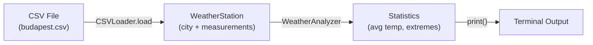
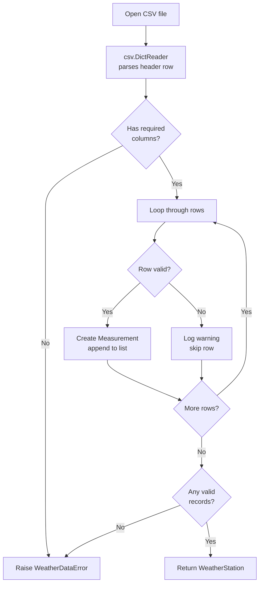
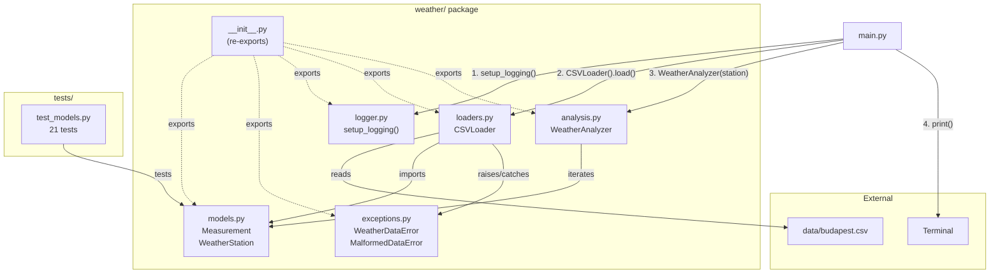

# Weather Data Explorer — Full Project Walkthrough (After Phase 1)

> **Audience:** Junior developers, teammates, or anyone reading this codebase for the first time.
> **Goal:** After reading this, you should understand *what* the project does, *how* every piece fits together, and *why* each design decision was made.

---

## 1. The Big Picture

### What is this project?

A **command-line Python toolkit** that:

1. **Loads** historical weather data from CSV (and later JSON) files
2. **Cleans** it — skipping broken/invalid rows instead of crashing
3. **Analyses** it — computing statistics like averages, extremes, and trends
4. **Visualises** it — generating plots and PDF/PNG reports

We're building it for **multiple cities** (right now we have Budapest, more coming).

### Where are we right now?

We've completed **Phase 1 out of 5**. Think of it as the **foundation** — all the core data structures, error handling, logging, and a basic CSV reader are working. The app can already load 1,827 days of Budapest weather data and print summary stats.

### How does the data flow?



That's it for now. In later phases, this pipeline will grow to include JSON loading, NumPy computations, Matplotlib plots, and PDF report generation.

---

## 2. Repository Layout — Every File Explained

```
WeatherDataExplorer/
├── data/
│   └── budapest.csv           ← Raw weather data (the input)
├── weather/                   ← The main Python package (our library)
│   ├── __init__.py            ← Makes 'weather' importable; exports public API
│   ├── exceptions.py          ← Custom error classes
│   ├── logger.py              ← Logging configuration helper
│   ├── models.py              ← Core data structures (Measurement, WeatherStation)
│   ├── loaders.py             ← Reads CSV files into our data structures
│   └── analysis.py            ← Computes statistics from the data
├── tests/                     ← Automated test suite
│   └── test_models.py         ← 21 tests for Measurement & WeatherStation
├── .vscode/settings.json      ← Editor: use .venv, hide cache folders
├── main.py                    ← Entry point — run this to see it work
├── pyproject.toml             ← pytest configuration (test paths, import path)
├── requirements.txt           ← Lists external libraries needed
├── README.md                  ← Setup & usage instructions
├── .gitignore                 ← Tells Git which files to ignore
├── Task.md                    ← Original project assignment
└── plan.md                    ← Our implementation roadmap
```

### Getting set up

Each developer works in a project-local **virtual environment** (`.venv/`, git-ignored), so dependencies never clash with other projects:

```bash
python3 -m venv .venv
source .venv/bin/activate
pip install -r requirements.txt
```

> [!NOTE]
> Python auto-creates `__pycache__/` (compiled bytecode) and pytest creates `.pytest_cache/`. Both are git-ignored and hidden in the editor — you can ignore them.

---

## 3. The Data — What We're Working With

[budapest.csv](data/budapest.csv) contains **1,827 rows** of daily weather observations for Budapest from **2021-10-17 to 2026-10-17** (about 5 years).

Each row looks like this:

| Column | Meaning | Example |
|--------|---------|---------|
| `date` | Calendar date | `2021-10-17 00:00:00` |
| `tavg` | Average temperature (°C) | `9.1` |
| `tmin` | Minimum temperature (°C) | `3.7` |
| `tmax` | Maximum temperature (°C) | `15.1` |
| `prcp` | Precipitation / rainfall (mm) | `0.5` or empty |
| `snow`, `wdir`, `wspd`, ... | Other columns we ignore | — |

> [!NOTE]
> Some rows have **empty precipitation values** — that's real-world data for you. Our code handles this gracefully by storing `None` instead of crashing.

---

## 4. The `weather` Package — Module by Module

### 4.1 [exceptions.py](weather/exceptions.py) — Custom Errors

**Why custom exceptions?** Python's built-in exceptions (`ValueError`, `FileNotFoundError`) are too generic. When something goes wrong in *our* weather code, we want errors that carry *weather-specific* information.

We define **two** exception classes in a parent–child hierarchy:

```
Exception (Python built-in)
  └── WeatherDataError          ← "something went wrong with weather data"
        └── MalformedDataError  ← "this specific row (line X) is broken because Y"
```

```python
class WeatherDataError(Exception):
    """Big-picture problem: file not found, no valid records, etc."""

class MalformedDataError(WeatherDataError):
    """One bad row. Carries line_number and reason."""
    def __init__(self, line_number: int, reason: str) -> None:
        self.line_number = line_number
        self.reason = reason
        super().__init__(f"Line {line_number}: {reason}")
```

**Why a hierarchy?** So you can catch them at different levels:
- `except MalformedDataError` — handles just bad rows (the loader does this)
- `except WeatherDataError` — catches *everything* weather-related (the CLI could do this)

---

### 4.2 [logger.py](weather/logger.py) — Logging Setup

Instead of `print()` for debugging, we use Python's built-in `logging` module. This one function configures it for the whole app:

```python
def setup_logging(verbose: bool = False) -> None:
    level = logging.DEBUG if verbose else logging.INFO
    logging.basicConfig(
        level=level,
        format="%(asctime)s [%(levelname)s] %(name)s: %(message)s",
        datefmt="%H:%M:%S",
    )
```

**What does this produce?**

```
20:34:46 [INFO] weather.loaders: Loaded 1827 records for Budapest from budapest.csv
```

Each log line shows: **time** → **severity** → **which module** → **message**.

**How modules use it:** Every module creates its own logger with `logger = logging.getLogger(__name__)`, then calls `logger.info(...)`, `logger.warning(...)`, etc. The `setup_logging()` call in `main.py` controls what level actually gets printed.

---

### 4.3 [models.py](weather/models.py) — Core Data Structures

This is the **heart of the project**. It defines the two main classes that all other modules work with.

#### `Measurement` — One Day's Weather

```python
@dataclass(frozen=True, slots=True)
class Measurement:
    date: datetime.date
    tavg: float          # average temperature
    tmin: float          # minimum temperature
    tmax: float          # maximum temperature
    prcp: float | None = None  # precipitation (optional)
```

**Key Python concepts here:**

| Concept | What it does | Why we use it |
|---------|-------------|---------------|
| `@dataclass` | Auto-generates `__init__`, `__eq__`, `__hash__` | Avoids boilerplate — we just declare fields |
| `frozen=True` | Makes instances **immutable** (can't change after creation) | Weather readings are facts; they shouldn't change |
| `slots=True` | Uses `__slots__` instead of `__dict__` | Slightly faster and uses less memory |
| `float \| None` | Union type hint (Python 3.10+) | Precipitation can be missing (`None`) |

**Dunder methods we added manually:**

- **`__lt__`** (less-than): Compares measurements by date. This is what makes `sorted(measurements)` produce chronological order.

  ```python
  def __lt__(self, other):
      if not isinstance(other, Measurement):
          return NotImplemented     # tells Python "I can't compare with this type"
      return self.date < other.date
  ```

- **`__repr__`**: A human-readable string representation for debugging:
  ```
  Measurement(2024-01-15, tavg=5.0, tmin=-2.0, tmax=10.0, prcp=1.3)
  ```

#### `WeatherStation` — A City's Entire Dataset

```python
class WeatherStation:
    def __init__(self, city: str, measurements: list[Measurement]) -> None:
        self.city = city
        self.measurements = sorted(measurements)  # always chronological!
```

**Dunder methods:**

- **`__len__`**: `len(station)` → returns how many days of data we have
- **`__iter__`**: `for m in station:` → lets you loop over measurements directly
- **`__repr__`**: `WeatherStation(city='Budapest', records=1827)`

**Instance method — `filter_dates`:**

```python
def filter_dates(self, start_date=None, end_date=None) -> WeatherStation:
    filtered = [
        m for m in self.measurements
        if (start_date is None or m.date >= start_date)
        and (end_date is None or m.date <= end_date)
    ]
    return WeatherStation(self.city, filtered)   # returns a NEW station
```

This uses a **list comprehension** to create a subset. Notice it returns a *new* `WeatherStation` — the original is never modified. This is a pattern called **immutable filtering**.

> [!IMPORTANT]
> `WeatherStation` auto-sorts measurements on construction. So even if you pass jumbled data, `.measurements[0]` is always the earliest date and `.measurements[-1]` is the latest.

---

### 4.4 [loaders.py](weather/loaders.py) — Reading CSV Files

The `CSVLoader` class reads a `.csv` file and converts each row into a `Measurement` object, collecting them into a `WeatherStation`.

**The loading flow:**



**Validation rules applied to each row:**

0. **Header must contain** every name in `REQUIRED_COLUMNS` (`date`, `tavg`, `tmin`, `tmax`) — otherwise the whole file is rejected, naming the missing columns
1. **Date must be parseable** as an ISO date
2. **`tavg`, `tmin`, `tmax` must be valid numbers**
3. **Temperature order**: `tmin ≤ tavg ≤ tmax` (otherwise it's nonsense data)
4. **Precipitation can be empty** (becomes `None`) but **can't be negative**

**What happens when a row fails?** It does NOT crash the program. Instead:
1. A `MalformedDataError` or `ValueError` is caught
2. The row is logged as a warning: `Skipping row 42: Negative precipitation: -5.0`
3. Processing continues to the next row

This approach is called **defensive programming** — the app is tolerant of imperfect data.

**Key Python features used here:**

| Feature | Where | What it does |
|---------|-------|-------------|
| `REQUIRED_COLUMNS` | Line 19 | Module-level `frozenset` constant; set difference finds missing columns |
| `csv.DictReader` | Line 58 | Reads CSV rows as dictionaries (`{"date": "2024-01-01", "tavg": "5.0", ...}`) |
| `pathlib.Path` | Throughout | Object-oriented file paths (better than string manipulation) |
| `encoding="utf-8-sig"` | Line 57 | Handles the BOM (byte-order mark) that some CSV exports include |
| `logging.getLogger(__name__)` | Line 17 | Creates a logger named `"weather.loaders"` |
| `try/except` | Lines 67–101 | Catches row-level errors without stopping the entire load |

---

### 4.5 [analysis.py](weather/analysis.py) — Basic Statistics

Currently a **minimal placeholder** that will be massively expanded in Phase 3:

```python
class WeatherAnalyzer:
    def __init__(self, station: WeatherStation) -> None:
        self.station = station

    def average_temperature(self) -> float:
        return mean(m.tavg for m in self.station)  # generator expression!

    def hottest_day(self) -> Measurement:
        return max(self.station, key=lambda m: m.tmax)

    def coldest_day(self) -> Measurement:
        return min(self.station, key=lambda m: m.tmin)
```

**Notice** how `for m in self.station` works — that's because `WeatherStation` has `__iter__`. Without that dunder method, this code would fail.

The `key=lambda m: m.tmax` pattern tells `max()` to compare by `tmax` instead of the default (`__lt__`, which compares by date).

---

### 4.6 [\_\_init\_\_.py](weather/__init__.py) — Package Exports

```python
from weather.analysis import WeatherAnalyzer
from weather.exceptions import MalformedDataError, WeatherDataError
from weather.loaders import CSVLoader
from weather.logger import setup_logging
from weather.models import Measurement, WeatherStation

__all__ = ["CSVLoader", "WeatherAnalyzer", "Measurement", "WeatherStation", ...]
```

**What does this do?** It lets users write convenient imports:

```python
from weather import CSVLoader, WeatherAnalyzer  # clean!
```

Instead of:

```python
from weather.models import Measurement            # verbose
from weather.models import WeatherStation
```

The `__all__` list documents exactly which names are part of the public API.

---

## 5. [main.py](main.py) — Entry Point

This is what you run: `python3 main.py`

```python
def main() -> None:
    setup_logging()                                     # 1. Configure logging

    data_path = Path(__file__).resolve().parent / "data" / "budapest.csv"  # 2. Build path

    station = CSVLoader().load(data_path, "Budapest")   # 3. Load data
    analyzer = WeatherAnalyzer(station)                 # 4. Create analyzer

    hottest = analyzer.hottest_day()                    # 5. Compute stats
    coldest = analyzer.coldest_day()

    print("=== Weather Data Explorer ===")              # 6. Display results
    print(f"City: {station.city}")
    print(f"Records: {len(station)}")
    # ...
```

**Output:**

```
20:34:46 [INFO] weather.loaders: Loaded 1827 records for Budapest from budapest.csv
=== Weather Data Explorer ===
City: Budapest
Records: 1827
Date range: 2021-10-17 → 2026-10-17
Average temperature: 12.85 °C
Highest temperature: 39.1 °C (2026-08-05)
Lowest temperature:  -10.7 °C (2026-01-09)
Missing precipitation values: 247
```

---

## 6. The Test Suite — [test_models.py](tests/test_models.py)

We have **21 tests** organised into two test classes. Here's what each group verifies:

### `TestMeasurement` (10 tests)

| Test | What it checks |
|------|----------------|
| `test_construction_with_all_fields` | All 5 attributes are stored correctly |
| `test_precipitation_defaults_to_none` | Omitting `prcp` gives `None` |
| `test_frozen_raises_on_assignment` | Can't modify a measurement after creation |
| `test_lt_compares_by_date` | Earlier date < later date |
| `test_lt_returns_not_implemented_for_other_types` | Comparing with a string returns `NotImplemented` |
| `test_sorted_produces_chronological_order` | `sorted([jumbled list])` → oldest first |
| `test_repr_with_prcp` | String representation shows precipitation value |
| `test_repr_without_prcp` | String representation shows `N/A` for missing |
| `test_equality` | Two identical measurements are `==` |
| `test_inequality` | Different measurements are `!=` |

### `TestWeatherStation` (11 tests)

| Test | What it checks |
|------|----------------|
| `test_len` | `len(station)` returns record count |
| `test_iter_yields_measurements_in_order` | `for m in station` gives chronological order |
| `test_constructor_sorts_measurements` | Measurements are sorted even if input is jumbled |
| `test_city_attribute` | `.city` stores the name correctly |
| `test_repr` | String representation is readable |
| `test_filter_dates_both_bounds` | Filtering with start AND end date |
| `test_filter_dates_open_start` | Filtering with only an end date |
| `test_filter_dates_open_end` | Filtering with only a start date |
| `test_filter_dates_no_bounds` | Filtering with no bounds returns everything |
| `test_filter_returns_new_station` | Filtering creates a *new* object (original unchanged) |
| `test_empty_station` | Edge case: station with zero measurements works |

### How the tests use **fixtures**

```python
@pytest.fixture
def sample_measurements():
    """Reusable test data — 5 measurements, deliberately out of order."""
    return [
        Measurement(datetime.date(2024, 1, 3), 2.0, -1.0, 5.0, 0.5),
        Measurement(datetime.date(2024, 1, 1), 0.0, -3.0, 4.0, None),
        # ...
    ]

@pytest.fixture
def station(sample_measurements):
    """A WeatherStation built from the sample data."""
    return WeatherStation("TestCity", sample_measurements)
```

**What is a fixture?** It's pytest's way of saying "before running a test, prepare this data and pass it in." Any test method that has `station` as a parameter automatically gets a fresh `WeatherStation` instance.

**To run the tests** (from the project root, with `.venv` active):
```bash
pytest        # add -v for one line per test
```

No path is needed: [pyproject.toml](pyproject.toml) tells pytest where tests live (`testpaths`) and puts the project root on the import path (`pythonpath`), so `from weather.models import ...` just works. That's why `tests/` needs no `__init__.py`.

---

## 7. Python Concepts Cheat Sheet

Here's a quick reference of every Python technique this codebase demonstrates, with links to where:

| Concept | Example | File |
|---------|---------|------|
| **Dataclass** | `@dataclass(frozen=True, slots=True)` | [models.py](weather/models.py#L16-L17) |
| **Dunder `__lt__`** | Enables `sorted()` on measurements | [models.py](weather/models.py#L42-L46) |
| **Dunder `__len__`** | Enables `len(station)` | [models.py](weather/models.py#L75-L77) |
| **Dunder `__iter__`** | Enables `for m in station` (typed `Iterator[Measurement]`) | [models.py](weather/models.py#L79-L81) |
| **Dunder `__repr__`** | Human-readable `repr()` | [models.py](weather/models.py#L50-L55) |
| **Custom exceptions** | `WeatherDataError` → `MalformedDataError` | [exceptions.py](weather/exceptions.py) |
| **Exception hierarchy** | `except MalformedDataError` vs `except WeatherDataError` | [loaders.py](weather/loaders.py#L97-L101) |
| **Logging** | `logging.getLogger(__name__)` | [loaders.py](weather/loaders.py#L17) |
| **Module constant + set ops** | `REQUIRED_COLUMNS - set(fieldnames)` | [loaders.py](weather/loaders.py#L19) |
| **`csv.DictReader`** | Reads CSV rows as dictionaries | [loaders.py](weather/loaders.py#L58) |
| **`pathlib.Path`** | Object-oriented file path handling | [loaders.py](weather/loaders.py#L50) |
| **`datetime`** | Date parsing and storage | [models.py](weather/models.py#L11), [loaders.py](weather/loaders.py#L68) |
| **`statistics.mean`** | Average temperature | [analysis.py](weather/analysis.py#L9) |
| **List comprehension** | `[m for m in self.measurements if ...]` | [models.py](weather/models.py#L98-L103) |
| **Generator expression** | `mean(m.tavg for m in self.station)` | [analysis.py](weather/analysis.py#L22) |
| **Lambda** | `key=lambda m: m.tmax` | [analysis.py](weather/analysis.py#L25) |
| **Type hints** | `-> float`, `float \| None` | Throughout |
| **`pytest` fixtures** | `@pytest.fixture` for reusable test data | [test_models.py](tests/test_models.py#L23-L37) |
| **`pytest.raises`** | Testing that exceptions are raised | [test_models.py](tests/test_models.py#L59-L62) |
| **Package `__init__.py`** | Re-exports for clean imports | [\_\_init\_\_.py](weather/__init__.py) |

---

## 8. How Everything Connects — The Full Picture



**Reading the diagram:**
1. `main.py` starts by calling `setup_logging()` from `logger.py`
2. It creates a `CSVLoader` and calls `.load()` — which reads the CSV, validates rows, and returns a `WeatherStation` full of `Measurement` objects
3. The `WeatherStation` is passed to a `WeatherAnalyzer` that computes stats
4. Results are printed to the terminal
5. The `tests/` folder independently tests the `models.py` classes with synthetic data

---

## 9. Glossary

| Term | Meaning |
|------|---------|
| **Dataclass** | A Python decorator (`@dataclass`) that auto-generates `__init__`, `__eq__`, and `__repr__` from type-annotated fields |
| **Frozen** | A dataclass setting that makes instances immutable — you can't change attributes after creation |
| **Slots** | A memory optimisation that stores attributes in a fixed array instead of a dictionary |
| **Dunder method** | "Double-underscore" methods like `__len__`, `__iter__` — they let your objects work with built-in Python syntax (`len()`, `for ... in`, `sorted()`) |
| **Fixture** | A pytest feature that creates test data before each test runs |
| **Defensive programming** | Writing code that handles bad input gracefully instead of crashing |
| **List comprehension** | `[x for x in items if condition]` — a concise way to filter/transform lists |
| **Generator expression** | Like a list comprehension but with `()` — produces values lazily (one at a time) |
| **BOM** | Byte Order Mark — an invisible character some editors add at the start of files; `utf-8-sig` handles it |

---

## 10. What's Coming Next

| Phase | Focus | Key additions |
|-------|-------|---------------|
| **Phase 2** | Ingestion & Validation | `BaseLoader(ABC)` → `JSONLoader`, second city dataset, `load_dataset()` dispatcher, `test_loaders.py` |
| **Phase 3** | Computations | NumPy rolling means, anomaly detection, `defaultdict` grouping, `Counter` categories, `itertools.groupby` streaks |
| **Phase 4** | Plotting & Reports | Matplotlib line/histogram/heatmap, `Report` class generating PDF/PNG |
| **Phase 5** | CLI & Docs | Full `argparse` CLI, complete test suite, design document, class diagram, README |
